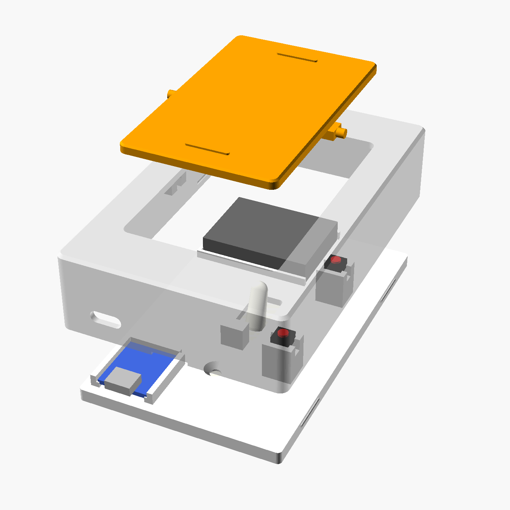

# Scene Switch Cover

A 3D-printed cover for a standard US toggle light switch. It holds the real switch **ON** so your smart bulbs always have power, and puts a rocker paddle in front. Press the top or bottom of the paddle and an ESP32 inside fires a Home Assistant scene.



## Files

| File | What it is |
|---|---|
| `stl/base.stl` | Plate that screws onto the real switch with the normal 2 screws. Holds the ESP32, battery and buttons. |
| `stl/shell.stl` | Cover that snaps over the base. Already rotated front-face-down for printing. |
| `stl/rocker.stl` | The paddle you press. Already rotated face-down for printing. |
| `scene_switch_cover.scad` | Editable OpenSCAD source. Every size is a variable at the top. |
| `esphome/scene-switch.yaml` | ESP32 firmware (ESPHome). |
| `esphome/home-assistant-automation.yaml` | Automation that maps top/bottom to scenes. |

## Parts list (about $15 per switch)

- Seeed **XIAO ESP32-C6** (or the C3/S3 version; same footprint). It has a built-in LiPo charger.
- **803040 LiPo** cell, 3.7 V **1000 mAh** (8 × 30 × 40 mm), with a protection board and JST/wire leads. The battery bay is 41 × 31 mm and up to about 15 mm tall, so a 103040 (about 1200 mAh, 10 mm thick) also fits. Measure the cell you buy *including* its protection board. The bay is open on the right side so the board and leads can stick out.
- 2 × **470 kΩ resistors** and 1 × **100 nF capacitor** for battery monitoring.
- 2 × **6×6×4.3 mm tactile switches**. If yours are 5 mm tall, set `tact_h_total = 5` and re-export.
- 2 × #6-32 flat-head screws (the ones from your old plate work).
- A little hot glue and some thin wire.

## Printing

- PETG is best. PLA works but can soften in a sunny spot.
- 0.2 mm layers, 3 walls, 20 % infill, no supports.
- Print one rocker first and test the fit. If the pins are too tight in the shell, raise `fit_clear` or the `pin_d + 0.3` slot clearance.

## Assembly

1. Turn off the breaker. Flip the real switch **UP** (on). Remove the old plate.
2. Screw `base` onto the switch. The small block under the toggle stops it being pushed down.
3. Hot-glue the 2 tactile switches into the pockets on the right-hand pillars. Run wires down the pillar slots.
4. Wire it up:
   - Top button to **D1**, bottom button to **D2**, other leg of both buttons to **GND**.
   - Battery red to **BAT+**, black to **BAT−** (pads on the underside of the XIAO).
   - Battery monitor: a 470 kΩ resistor from **BAT+** to **D0**, another 470 kΩ from **D0** to **GND**, and the 100 nF capacitor from **D0** to **GND**. These are tiny and can be soldered right onto the pins.

   ```
   BAT+ ──[470k]──┬──[470k]── GND
                  ├── D0
                  └──[100nF]── GND
   ```
5. Set the XIAO in its cradle with the USB-C port facing **down** so it lines up with the charging hole. Put the battery in its corral.
6. Snap the rocker pins into the shell from behind, then press the shell onto the base. Use the notch at the bottom to pry it off later.
7. Turn the breaker back on.

## Firmware

1. In the Home Assistant ESPHome add-on, create a device and paste in `esphome/scene-switch.yaml`. Rename it per room.
2. Flash it once over USB. After that, updates go over Wi-Fi during the 5-minute window after you plug in USB power.
3. Add the automation from `esphome/home-assistant-automation.yaml` and swap in your own scenes.

**Response time:** about 1–2 seconds, because the ESP32 has to wake up and join Wi-Fi. A static IP brings it closer to 1 second. If you want it instant, flash the C6 with Zigbee firmware and pair it to ZHA or Zigbee2MQTT instead (the hardware is the same).

**Battery reporting:** Home Assistant gets two entities, **Battery** (%) and **Battery voltage**. They update on every press, and the ESP32 also wakes on its own every 12 hours to report, so readings keep coming even if nobody uses the switch. The second automation in `home-assistant-automation.yaml` sends a phone alert below 15 %.

**Battery life (1000 mAh, estimated, not measured):**

| Use | Estimate |
|---|---|
| 20 presses a day | about 14 months |
| 50 presses a day | about 7 months |
| 50 a day on slow Wi-Fi (5 s to connect) | about 4 months |

These assume about 19 µA asleep (board plus battery monitor), about 2.5 s of Wi-Fi per wake at around 90 mA, and 80 % of the battery being usable. A **static IP** (in the YAML) matters most, because it cuts connection time. Recharge through the USB-C hole at the bottom. A full charge takes several hours.

## Why it doesn't take power from metal contacts (yet)

Plug covers like SnapPower's GuideLight can draw power because an outlet always has hot *and* neutral at its side screws. A light switch is different:

- With the switch held **ON**, both screw terminals are at the same voltage. There's nothing to draw from.
- Most older switch boxes have **no neutral wire** at all.
- Products that do this (like SnapPower SwitchLight) are UL-listed, with insulated spring clips. A printed plastic part with exposed 120 V contacts that you pull on and off isn't safe.

If your box **does** have a neutral (common in houses wired after about 2011), a mains version is possible. An electrician would wire a listed 5 V module, such as a Hi-Link HLK-PM01, to line and neutral, and the battery corral is roughly the right size for it. I'd still start with the battery version.

## Adjusting the design

Open `scene_switch_cover.scad` in [OpenSCAD](https://openscad.org) (free). Change a variable and press F6, then File → Export → STL. To export one part from the command line:

```
openscad -D 'part="shell"' -o shell.stl scene_switch_cover.scad
```

Useful variables: `depth` (how far it sticks out, 27 mm by default), `tact_h_total`, `fit_clear`, `toggle_keeper`, `usb_hole`.
